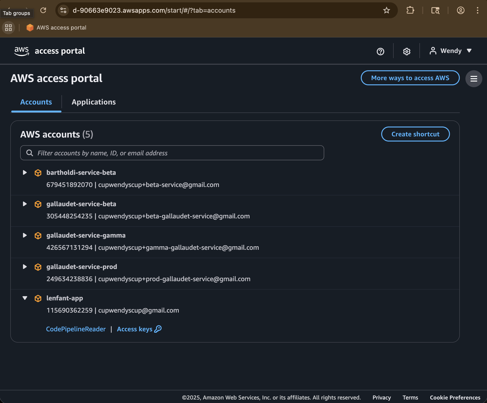
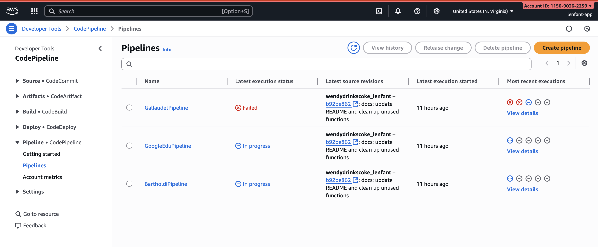
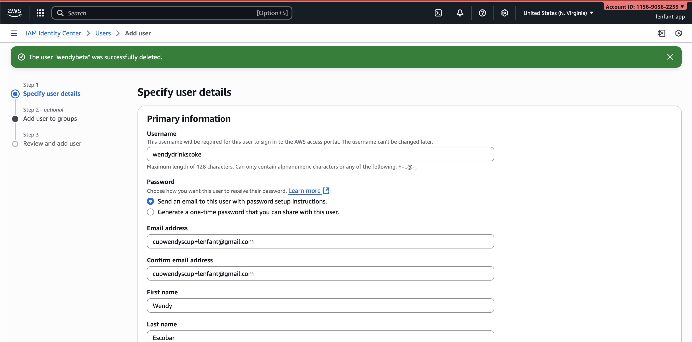
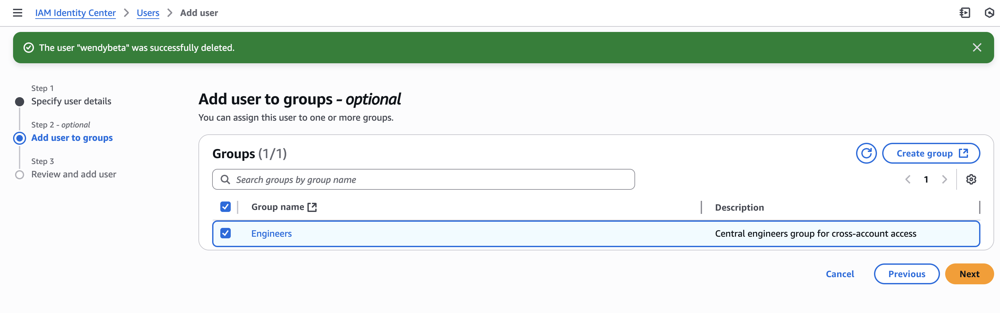
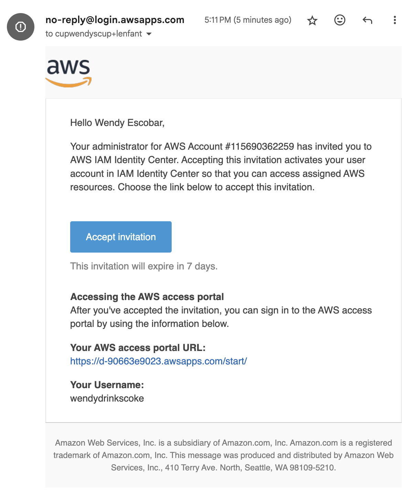

# Lenfant

Pierre Charles L'Enfant was an engineer whose "L'Enfant Plan" shaped the skyline
of our nation's capitol, D.C. Given the upcoming launch of DC3 (the latest
iteration of the beloved Roblox game, 
[Washington, D.C.](https://www.roblox.com/games/1213026131/Washington-D-C)), it 
is fitting that this monorepo be named in honor of such a central figure in DC's
history.

Note that this repo does not contain any code for the DC3 Roblox game itself. 
Rather, it contains (at the moment) two work-in-progress projects that will 
integrate with and enhance the experience of DC3: Bartholdi and Gallaudet. 

The first (WIP) project is called Bartholdi. Bartholdi is the backend 
microservice which will support the NUSA iOS application. The NUSA iOS 
application will integrate with Apple Push Notification Service (APNS) to notify
users of important events that may be starting, such as a new Congressional 
session. Users of the app will be able to create a Cognito user in the Bartholdi
service simply by completing a Roblox-based authentication. And in the app they
will be able to see relevant content to the game.

The second (WIP) project is called Gallaudet. Gallaudet contains both a backend
microservice and a frontend website: https://school.civictech.llc. The goal for
Gallaudet is to integrate the DC3 Roblox game with Google Classroom. 
Specifically, Gallaudet will enable teacher's to add as attachments tasks–such
as drafting a bill, touring the White House, etc.–that must be completed in-game
in DC3. Students will see these tasks in-game and they will be automatically
graded when the player completes them. In order to begin playing, students must
go through an onboarding flow which associates their Google account with their
Roblox account. 

## Quick Start
To get a workspace cloned and built, run the following shell commands:
```
git clone https://github.com/wendydrinkscoke/lenfant.git &&
cd lenfant &&
brew install openjdk@17 &&
sudo ln -sfn $(brew --prefix openjdk@17)/libexec/openjdk.jdk /Library/Java/JavaVirtualMachines/openjdk.jdk &&
npm install -g pnpm &&
npm install -g @aws/pdk &&
pnpm i
```
Enter your local user password.
```
pdk build
```

## Editing sub-project settings

The monorepo is an [AWS PDK](https://www.apple.com/startpage/) project. In order
to make configuration-level changes to any project, you should not directly edit
configuration files such as the `.gitignore`, `.tsconfig`, etc. Rather, you 
should only edit the `.projenrc.ts`, then run `projen` or `pdk` in the root 
`/lenfant` folder in order to ensure your changes take effect.

## Building the project

To build the project, you can run `projen build` or `pdk build` in the root 
`/lenfant` folder.

## Developing the Gallaudet frontend

To test changes on localhost, run `projen dev` in the 
`lenfant/packages/gallaudet-site` folder. 

## Deploying changes

All projects are leveraging CI/CD via GitHub and AWS CodePipelines. Simply
pushing a commit to the GitHub repo will trigger a deployment via CodePipelines.
Additionally, to check the progress of any deployment, you may log into the `lenfant-app` account (`115690362259`) from the 
[AWS Access Portal](https://d-90663e9023.awsapps.com/start/#/?tab=accounts)
using the `CodePipelineReader` role. The management stack, which provisions new
AWS accounts and assigns permissions for them to user groups, must be deployed
manually via `pdk build && cd ./packages/infra && pdk deploy ManagementStack`.

---



_The AWS Access Portal_

---

There are three pipelines which exist in the lenfant-app account:
1. GallaudetPipeline
1. GoogleEduPipeline
1. BartholdiPipeline



## Account Management

`lenfant-app` (`115690362259`) is the "management account" for an AWS 
organization that includes the following child accounts:
- `bartholdi-service-beta` (`679451892070`)
- `bartholdi-service-gamma` (`582182559291`)
- `bartholdi-service-prod` (`174512274702`)
- `gallaudet-service-beta` (`305448254235`)
- `gallaudet-service-gamma` (`426567131294`)
- `gallaudet-service-prod` (`249634238836`)

Each of these accounts was created via the 
[ManagementStack](./packages/infra/src/stacks/management-stack.ts).

## User/Role Management

Users and groups are managed via IAM Identity Center. One key difference between
the way users and groups are managed is that a user is created and assigned
to a group **manually in the console**, whereas the groups (i.e. Engineers) and
their permissions are configured via **infrastructure as code** in the 
`ManagementStack`. The following creenshots show how an admin can create a new
user and add them to the engineers group, as well as the invitation the 
soon-to-be Lenfant engineer will see in their email inbox:







## Domain Management

The `lenfant-app` account contains the following hosted zones:
- school.civictech.llc
- gedu.demo.civictech.llc
- bartholdi.org
- robloxnusa.academy (deprecated)

Both `bartholdi.org` and `robloxnusa.academy` were purchased through the R53 
Registrar, whereas the `school.civictech.llc` and `gedu.demo.civictech.llc`
domains were delegated to us by the owners of `civictech.llc` top-level domain. 
It is my understanding that the TLD is not hosted on R53 and hence why it was a
manual process for them to delegate that sub-domain to us. The process for that
was essentially to:
1. Provision `gedu.demo.civictech.llc` and `school.civictech.llc`.
1. Look at the NS record which R53 automatically created when we provision the
hosted zone.
1. Send the four name servers which related to each hosted zone to the owners
of `civictech.llc` via Discord so they can configure the root domain to route
all requests to those sub-domains to our infrastructure. Likely, this means
they created, for each domain we requested, an NS record in their hosted zone 
with record name equal to the subdomain we're asking for and record value equal 
to the four name servers we sent.

I chose to keep all root hosted zones (including project-specific ones like
`school.civictech.llc`) in the management account. I considered moving 
`school.civictech.llc` to `gallaudet-service-prod` (`249634238836`) so it could
handle its own subdomain delegation, but opted against it. The tradeoff is we
must provision a cross-account IAM role so `gallaudet-service-prod` can 
create/update DNS records in the management-owned zone. Key benefits are:
1. reduced doxxing exposure—project owners can have broad perms in their 
accounts to use the hosted zone without visibility into domain registration 
data
1. centralized DNS governance and auditability in one place
1. lower blast radius and simpler incident response since root zones can’t be
modified or deleted from project accounts