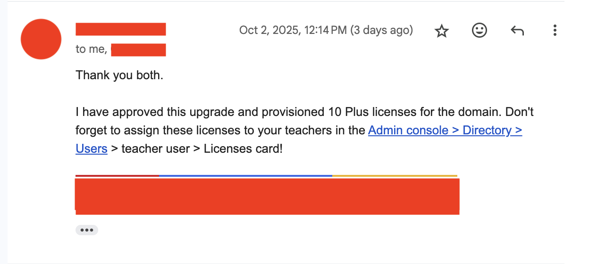
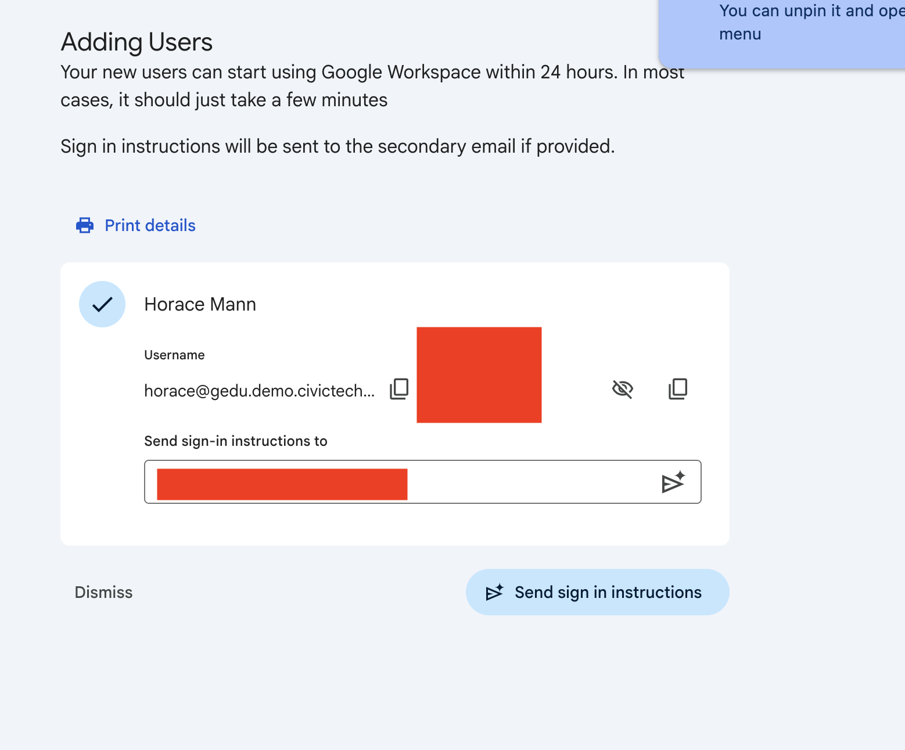
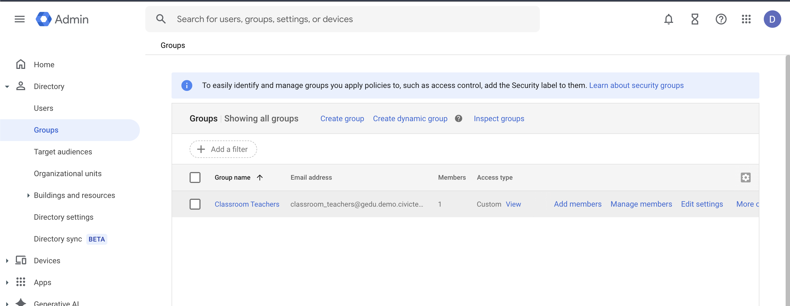
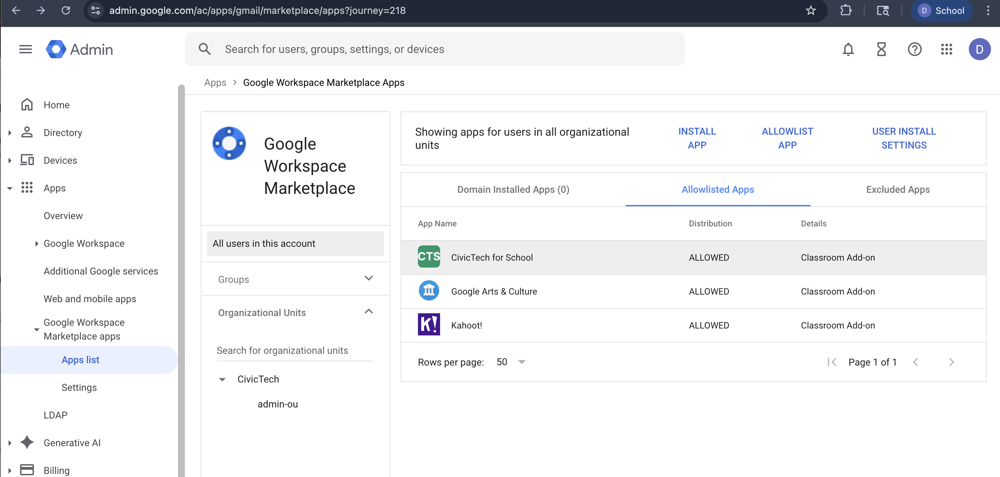
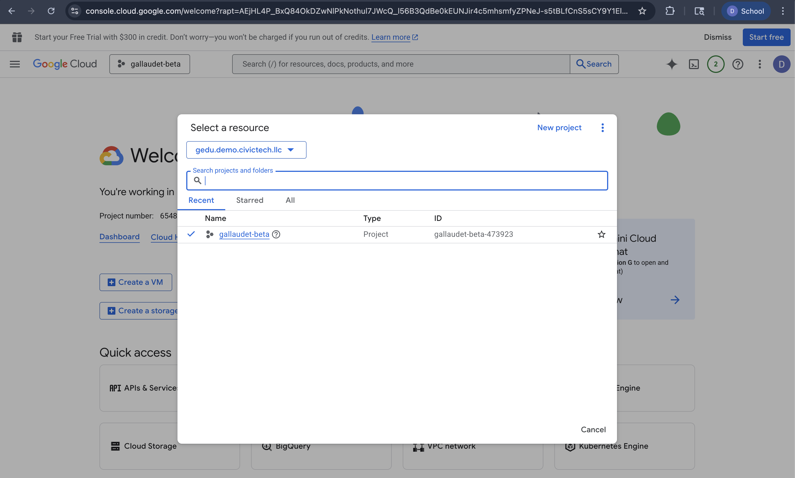
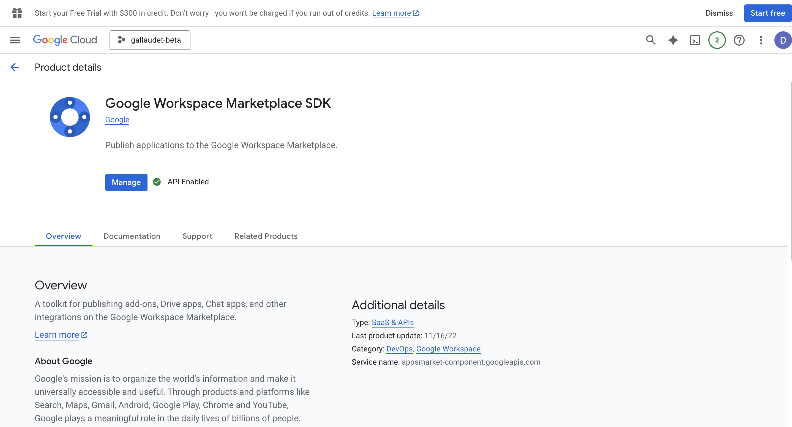
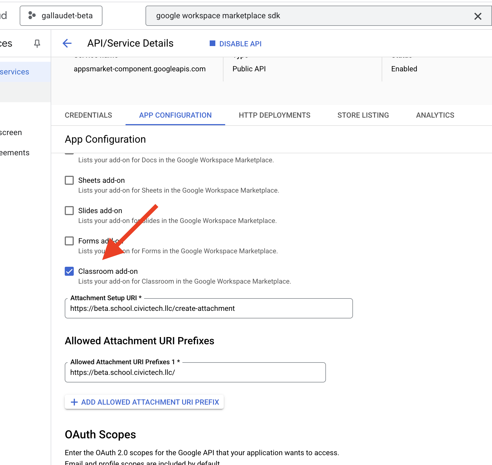

# Gallaudet Site

The `gallaudet-site` package is responsible for building the frontend UI that
appears on https://school.civictech.llc.

## Purpose
The Gallaudet project generally, which is comprised of the `gallaudet-api` and
`gallaudet-site` packages, is meant to integrate the "Washington, D.C." Roblox
game with Google Classrooms. In particular, we are developing a Google Classroom
Add-On.

### Future Directions

1. Store details about the tasks we attach to assignments in DDB, indexed by the
courseId and itemId. Currently, we do call the Google Classrooms API and *they*
store details just the task/attachment title. Although the title does contain
some task-related details (i.e. if the task is filibuster a bill, it'll have
filibuser a bill as the title), we don't want to use Google Classrooms as our
data store and do some jank stuff where we parse the titles of tasks. Rather,
we want to store the task type, completion progress, and any other details in 
DDB. I'm not yet sure exactly what sort of data we'd end up storing about the 
task here, though, as opposed to what data we'd store on the game server. For
instance, I can forsee a world where the user writes a piece of legislation 
in-game and that is available for teachers to grade. Would we store that data
in our own database or just fetch it every time from the game's database for 
SSoT. Or, for example, a task like "Tour the WhiteHouse" might require the user
visit 6 different rooms. Where would we store their completion progress on
something like that? Will have to talk to game devs to see what they prefer when
they are implementing this acheivements engine. It seems like, if we want to
also integrate with Roblox "Badges" at the same time, the game would have to
manage it.

1. Create studentView and teacherView pages where they can view the assignment
instructions, details, completion progress, etc.

1. Create a "Enroll Students" task.
Within the `create-attachment` page, there are various types of tasks that can
be assigned. For instance, "Fillibuster a Bill". However, we don't yet have a
task that's like "Enroll Students". I'm thinking the "enroll students" task
would be assigned to students and it'd be the first task they have to complete.
Students would view this task within their classrooms UI and complete it by
logging in with their Google account (Cognito user creation) and then logging 
in with their Roblox account (to associate their Roblox user ID with their 
Google account). This is critical since, in order for us to show Classroom tasks
to Roblox users in-game, we need to know this mapping. Actually doing this will
likely require we set up Roblox as an OIDC provider on our Cognito user pool and
then somehow associate the Cognito user created during Google OAuth with the
Cognito user created during Roblox OAuth, but I'm not sure honestly. All I know
is it will likely not be a fully frontend solution with changes to 
`gallaudet-site` but rather will also require infrastructure changes in the
`gallaudet-api` package.

## Technology Stack

- As our frontend framework, we are using React.
- We are using `shadcn` as our component library. The reason I chose this is it
seems to work the best with AI code generators, such as https://v0.app. But one
thing to note is we are not using Next.JS so we have to modify the output of V0.
- We are using ReactBrowserRouter to handle navigation in the `index.tsx` file.
- Since we are using PDK, we have access to a type-safe client that we import
from the `gallaudet-api` project via 
`gallaudet-api-typescript-react-query-hooks`. You can call `getGallaudetApi()`
to retrieve a type-safe configured client, which retrieves its Cognito ID token
from 

## Deploying

The Gallaudet website is deployed via CI/CD. Commit your changes to the 
`wendydrinkscoke/lenfant` repository and the `GallaudetPipeline` will 
automatically deploy your changes. It is not possible at the moment to directly
deploy the website assets to beta. It's a bit annoying since the pipeline 
deployment does take like 15 minutes. 

## Testing

### Running the local development server

To start the development server, run 
`cd ../lenfant/packages/gallaudet-site && pdk dev`. Then navigate to 
`http://localhost:3000/` in your browser.

### Test domains

- http://beta.school.civictech.llc
- http://gamma.school.civictech.llc

### Test Workspace

As per [Google's developer documentation](https://shorturl.at/3wrHX), we have 
created a test domain `gedu.demo.civictech.llc`. This hosted zone exists in the
management account and so it's within that account that we prove ownership to
Google of this domain and forward emails to Google's servers. After creating
this workspace, we were able to create users, but they would not have the Google
for Education Plus License and thus not be valid test users for our private 
Classroom Add-On. Hence, we cut a "Google Workspace for Education demo domain 
upgrade request" using Google's online form and communicated with a Google 
employee in order to get access to licenses that we can assign to these test 
users.

### Test Users

For testing, the admin account (`admin@gedu.demo.civictech.llc`) provisioned
two test users: Brady Leibniz (brady@gedu.demo.civictech.llc) and Horace Mann 
(horace@gedu.demo.civictech.llc).  

We then added Brady Leibniz to the auto-generated "Classroom Teachers" group.

I also allowlisted our Marketplace listing for all users in the workspace.

## How the GCP Project was Configured

In the Google Cloud Console, a new project was created called `gallaudet-beta`
by `admin@gedu.demo.civictech.llc`. 

An OAuth client was created for this project also called `gallaudet-beta`. The
client ID and client Secret were copied into the `gallaudet-beta` account using
the `Bootstrapper` role and the client ID was also hard-coded into the frontend.
This OAuth client is internal only since it represents our beta project. No 
users except those within our organization will be able to authenticate to this
client. Next, we enabled the Google Workspace Marketplace SDK for this project
and created/published a **private** app listing.

## Marketplace Listings
- beta: https://workspace.google.com/marketplace/app/civictech_for_school/654823757539
- gamma: https://workspace.google.com/marketplace/app/civictech_for_schools_gamma/949890986084
- prod: https://workspace.google.com/marketplace/app/civictech_for_schools/648341560846